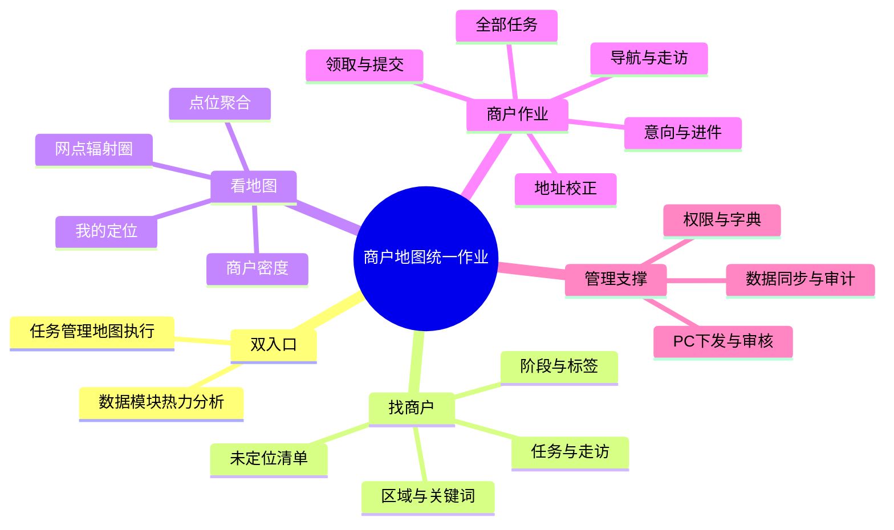
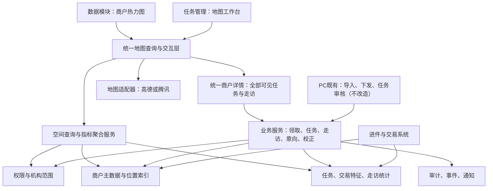
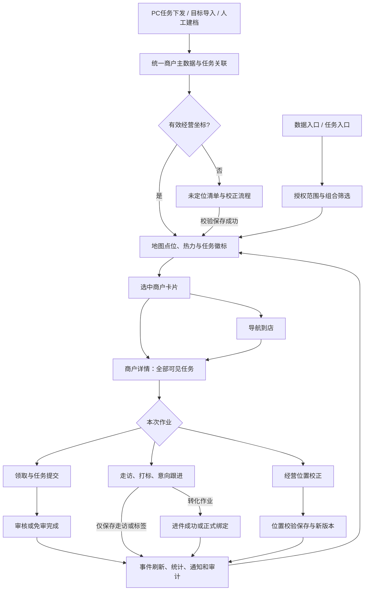
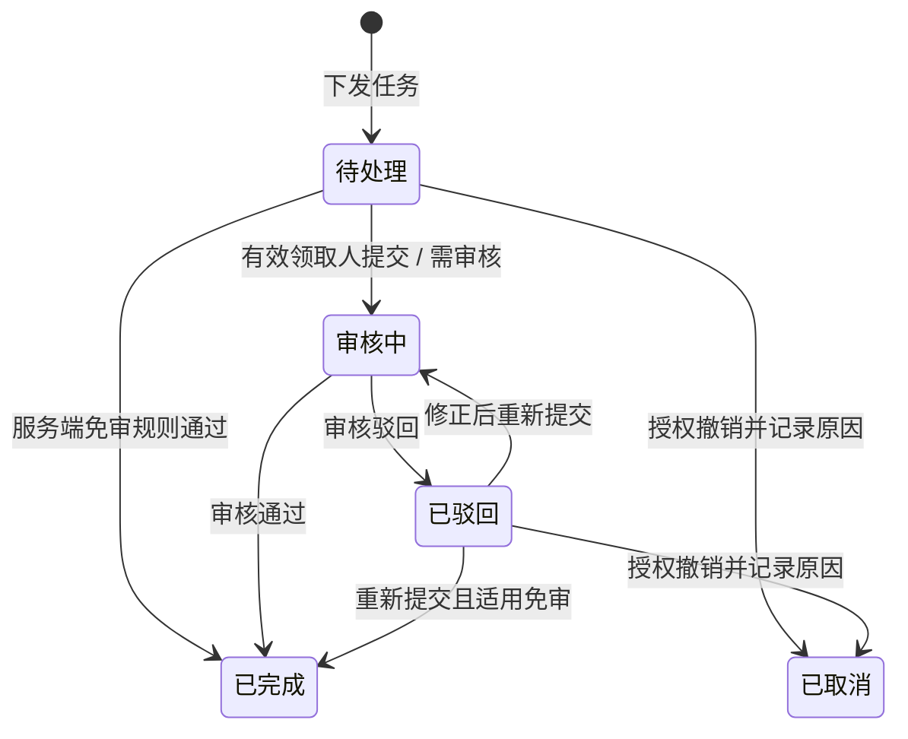
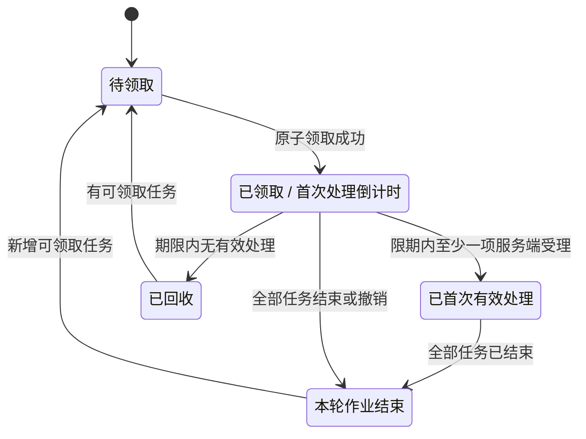
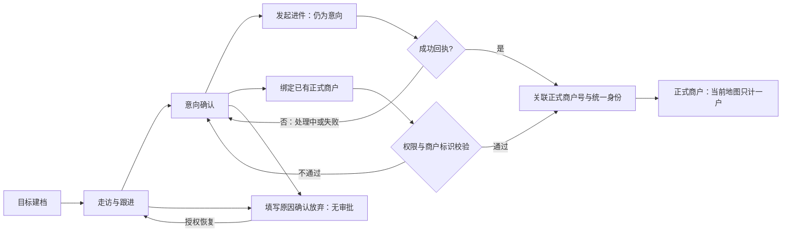
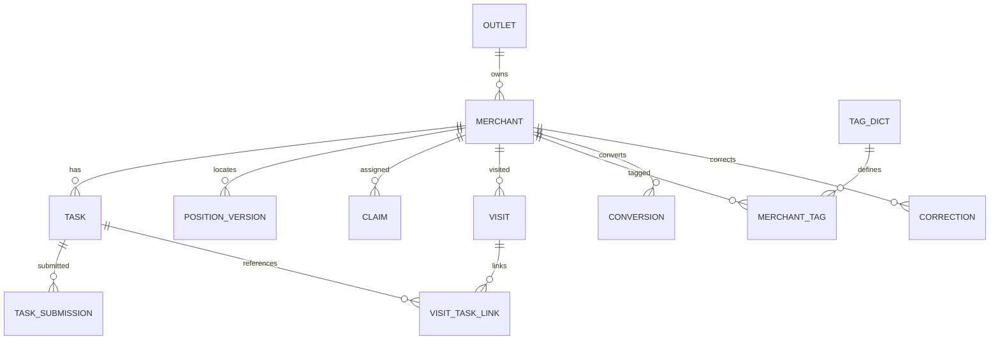
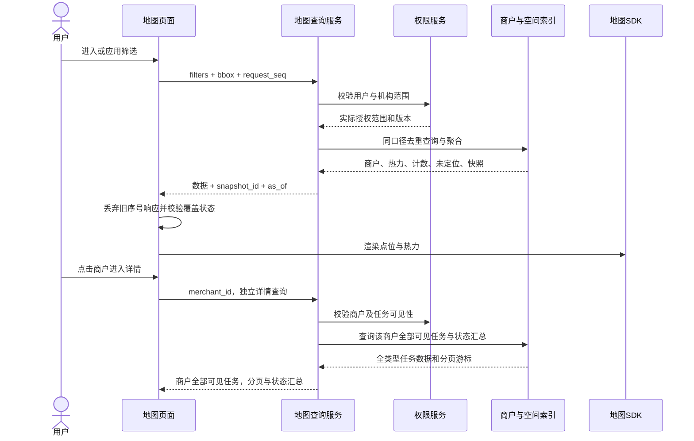
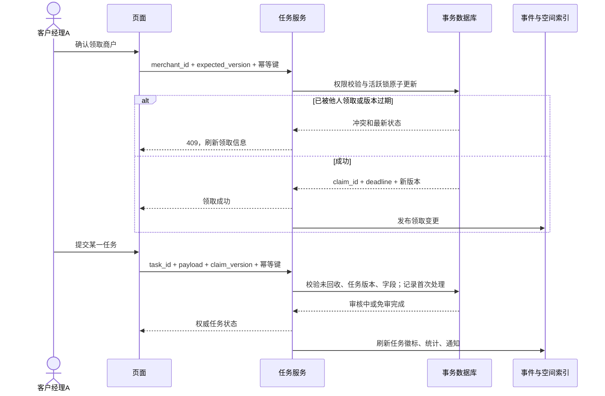
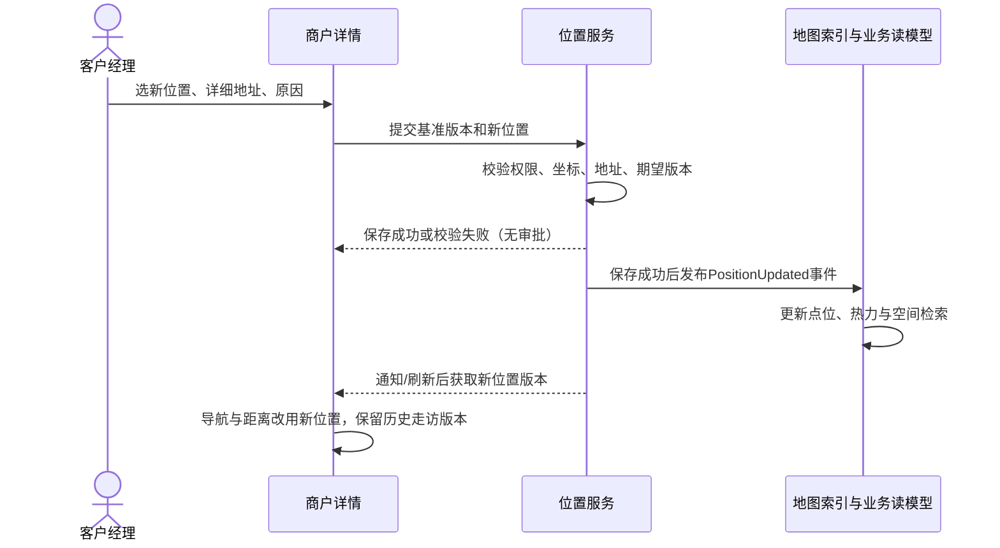

# 商户热力图与地图任务管理 PRD

> 版本：V1.1 业务口径修订稿 · 日期：2026-09-21 · 产品：微邮付 / 邮付管家  
> 本轮交付：方案、业务规则、交互、字段、图解、验收及移动端原型计划。原型改造尚未实施，真实地图尚未接入。已确认的业务口径见“已确认决策”，仍标为待定的内容只包括技术接入和研发实现细节。

## 1. 方案结论与阅读指南

**按“一户一个实际走访地址”处理商户，将地图升级为移动端任务管理的主工作台；同时在数据模块提供独立的“商户热力图”入口。** 这里的“一个商户一个地址”是本项目的产品视图：即使后台未来存在多个经营点，移动端本期也只展示商户当前维护的走访地址，不展开门店关系模型。

一套商户底座、两个入口、一个商户详情：数据入口重分析，任务入口重执行。地图点位代表商户，不代表单条任务；热力权重为去重商户数，不以任务条数、交易金额或点击次数替代。客户经理筛选“风控”找到商户后，仍应在详情中看到该商户的补资料、切换通道、走访、风控、挂账等全部**有权限查看**的任务。

### 1.1 核心决策

本轮只修订移动端方案及后续复制目录中的移动原型；PC 页面、功能、审核配置均不改造。文中 PC 仅作为现有任务来源和既有审核依赖。

| 议题 | 本稿建议 | 约束与原因 |
|---|---|---|
| 双入口 | 数据 → 商户热力图；任务管理 → 地图工作台 | 独立功能入口不能被任务管理吞并；无需维护两套商户数据 |
| 首屏 | 任务入口不再先选择存量/目标，直接地图 | 商户阶段改为筛选维度，取消新流程中的强制类型选择步骤，保留原版原型文件 |
| 商户集合 | 支持正式、目标、意向；任务入口默认“有未结束任务” | 数据入口默认“全部授权商户”，允许切至“有任务商户”；任务入口默认不展示仅有已结束任务的商户，可主动查询历史 |
| 点击地图 | 聚合点展开 → 单商户卡片 → 商户详情 | 一个商户对应一个当前维护地址；卡片不是任务详情 |
| 商户详情 | 全部任务按状态分组，独立于地图任务过滤 | 地图筛选只决定找出哪些商户，不截断商户的任务上下文 |
| 标签体系 | 阶段、活跃度、近期交易、场景、任务分别建模 | 非活跃不等于无任务；风控任务不等于商户已被判定风险 |
| 热力与圈层 | 商户密度热力；网点距离圈；可视区域查询 | 不恢复旧版已取消的围栏指派，不把辐射圈当行政/归属边界 |
| 地图平台 | H5 原型采用高德 JS API 2.0 + Loca 2.0 | 仅为原型实现选择；正式开发仍由技术评估平台、账号、Key、安全和费用 |

### 1.2 事实、继承与建议的边界

- **用户已明确**：热力图独立放数据模块；任务入口以地图筛选、查看、打标和操作；点位进入商户全任务详情；先出 HTML 与 Markdown 方案；复制移动端文件夹、保留原版。
- **既有设计待继承**：五类正式商户任务、按商户领取、3 天处理窗口、到期前 1 天提醒、审核/免审路径、目标到正式转化；原改造尚未上线，不能将原型描述成线上现状。
- **本轮已确认**：移动端按一户一个当前走访地址；任务入口默认未结束任务商户；活跃和近期交易按现有原型口径；领取 3 天按推荐定义；新任务沿用有效领取人；目标放弃无独立审批；任务审核沿用原有审核流程。
- **仍需技术评估**：高德 Key、域名/安全配置、配额、真机定位导航、热力性能及正式地图平台选型。
- **参考材料边界**：附件只用于参考巡店、点位开关、定位、导航、意向标记和地址校正等交互方式；不把附件中的行业、名单、历史数据或其他业务规则带入微邮付。

## 2. 背景、问题与目标

### 2.1 背景

旧需求针对按任务类型分散操作的问题，拟将正式商户任务按商户聚合，并建立目标商户走访转化链路。PC 负责商户任务下发、目标导入及审核；移动端负责领取、走访、处理和转化。目前这些内容主要是方案与静态 HTML 原型，并未完成此次改造上线。

浙江新增热力图需求，希望直观看到商户分布、走访拓展情况和不同经营特征。若仅在原列表旁新增地图开关，会出现两个入口口径不一致、多个任务重复形成热力、商户活跃与任务风险混色、查看和作业来回跳转等问题。因此需统一空间查询与商户数据模型。

### 2.2 业务目标与衡量方式

| 目标 | 设计方式 | 上线评估指标 / 采集口径 |
|---|---|---|
| 找得到商户 | 地图默认入口、搜索、组合筛选、未定位清单 | 首屏到选中商户耗时 P50/P95；定位失败后的继续使用率 |
| 一次到店处理多任务 | 商户详情完整任务上下文 | 单次走访关联的已提交任务数；同商户多任务处理覆盖率 |
| 看清分布和拓展 | 去重热力、阶段、走访和转化过滤 | 地图定位覆盖率 = 有有效坐标商户 / 授权商户；意向到正式转化率 |
| 管理数据可信 | 指标字典、数据时间、校正记录和商户标识一致性 | 统计对账差异数；校正保存成功率；重复商户率 |
| 降低操作负担 | 入口、卡片、详情复用 | 地图到详情步骤、返回上下文保持率、关键流程成功率 |

以上业务指标先建立基线，再由产品和浙江业务方确定改善目标，不在无线上样本时虚构提升百分比。转化率必须注明分母为指定建档期的意向商户及观察窗口，不能拿当日转化数除以当前意向存量。

### 2.3 角色与典型场景

- 客户经理：出门后看附近待办 → 按风控/切换通道筛选 → 找到商户当前维护地址 → 导航 → 在详情一次处理全部任务；顺路新增目标、记录意向。
- 网点负责人：查看本网点商户、待领取及即将回收情况，按原有权限处理任务审核，不新增校正审核。
- 区县/市/省机构管理人员：数据入口查看下辖分布、活跃结构、走访覆盖；下钻不突破机构权限；不默认获得现场打卡权。
- 运营/审核人员：PC 导入目标、下发任务、按原有流程复核任务；标签和网点沿用已有配置，本期不新增 PC 配置页。
- 外拓团队：仅当后续组织明确接入时走独立授权，不因旧背景提到外拓就自动开放整区商户。外部系统对接不是本期必做。

## 3. 范围与现有方案取舍

### 3.1 本期功能边界

| 优先级 | 功能 | 本期 PRD 定义 |
|---|---|---|
| P0 | 双入口、统一地图、商户详情全任务 | 必需 |
| P0 | 商户数、任务数、热力、点位聚合、定位导航 | 必需；明确未定位和异常态 |
| P0 | 阶段/活跃/交易/场景/任务筛选与标签 | 必需；标签值由业务数据服务供给 |
| P0 | 商户领取、原任务处理与审核衔接 | 保留原有业务能力，不能用地图重写其专业规则 |
| P0 | 目标/意向标记、走访记录、转化关系 | 必需；不以打开进件页面算转化成功 |
| P0 | 地址校正与操作留痕、网点及辐射圈 | 移动端能力；不新增校正审批或 PC 页面 |
| P0 | 机构权限、并发、幂等、数据时间与降级 | 上线门槛 |
| P1 | 保存个人筛选、移动端走访摘要与明细查看 | 不新增 PC 报表或导出功能 |
| 不纳入 | 地图围栏自动指派、最优拜访路线、连续轨迹监控 | 无本轮明确要求，避免扩展成调度系统 |
| 不纳入 | 完整经营驾驶舱、真实业务后端开发、地图采购 | 本轮为方案；历史“任务驾驶舱本期不做”仍保留 |

“热力图划分”本稿解释为按统一空间粒度统计密度及分档显示，不解释为画区域自动分配客户经理。若需商圈/责任区维护，应单独立项。

### 3.2 旧方案保留、替换与冲突解决

| 原设计 | 新方案处理 | 依据 |
|---|---|---|
| 先选存量或目标，再进列表/地图 | 替换为统一地图，阶段筛选 | 用户本次明确要求 |
| 以商户聚合所有任务 | 保留并强化，不按点位任务截断 | 原改造核心目标与本次一致 |
| 正式商户五种任务表单 | 保留字段校验、专业处理和审核 | 本轮不是通道、风控、挂账逻辑重做 |
| 地图仅看进行中，完成只能去列表 | 地图可选“全部/未结束/已完成”，默认未结束 | 地图作为主入口不能隐藏完成历史；历史分页查询 |
| 最近 90 天已完成列表 | 作为默认查询窗口，非记录删除期限 | 完整历史按时间范围查询，遵守保存策略 |
| 目标来源四种/两种冲突 | 展示分组为系统导入、手工录入；另存精确来源渠道 | 以整合说明为最新业务口径；渠道不等于生命周期 |
| 围栏拓客、区域点选指派 | 不恢复 | v6.0 明确取消；PC 地图找商户导出再导入仍可保留 |
| 新建重名/同电话一律阻止 | 硬唯一标识阻止重复；名称/电话相似进入复核 | 同名或共用联系人不代表同一商户；按商户标识区分 |
| 断网自动提交草稿 | 改为恢复后提示确认提交 | 任务归属、有效期可能已变化，不能静默写入 |

### 3.3 竞品能力对照（附件共 17 页）

| 附件页 | 参考能力 | 采用方式 / 差异 |
|---|---|---|
| 1–3、6、11–13 | 巡店入口、记录、明细与汇总 | 记录每次走访，汇总商户去重；区分走访次数与走访商户数 |
| 4 | 点位默认关闭、更新定位、商户卡片 | 数据热力入口默认点位关闭；任务入口默认开启，方便执行 |
| 5 | 100 米打卡、100 字备注、允许同日多次 | 作为建议初值，不视为微邮付既定制度；多次记录保留，商户数去重 |
| 7–10 | 意向标记、蓝色点位、转进件 | 保留意向字段与跳转；仅进件成功回执/核实绑定后转正式 |
| 14 | 校正地址及坐标 | 旧/新位置预览、详细地址、原因、确认保存和日志；不新增审批 |
| 15 | 用户位置、意向蓝、高频红、其他绿 | 不照搬红色高频方案，避免与风控警示冲突；本稿分层编码 |
| 16 | 网点、500/1000/2000 米圈、点位互斥 | 半径可选，图层独立；通过聚合和层级避免遮挡，不强制互斥 |
| 17 | 附近商户查找与快捷转化操作 | 仅参考交互；不引入附件的行业场景、名单、数据量或内外部商户池 |

## 4. 信息架构与页面结构

### 4.1 功能思维导图

### 4.2 逻辑架构

地图供应商不掌管业务权限，不产生平台任务，不计算微邮付活跃状态。空间索引和地图平台 POI 必须分开；POI 搜索命中不等于已有商户。

### 4.3 页面清单

| 编号 | 页面/面板 | 核心内容 | 主要去向 |
|---|---|---|---|
| M01 | 商户地图主页面 | 搜索、筛选、地图、图例、图层、计数、底部抽屉 | M02–M06 |
| M02 | 筛选面板 | 阶段、任务、标签、走访、来源、归属等 | 应用后回 M01 |
| M03 | 商户卡片/同址选择 | 单户信息、任务徽标、距离、详情/导航/领取 | M04、M05 |
| M04 | 统一商户详情 | 基础信息、全部任务、走访、标签、校正入口 | 原任务表单、M06–M09 |
| M05 | 导航选择 | 目的地址、地图服务、路线模式、兜底 | 外部地图/路线页 |
| M06 | 走访记录表单 | 位置校验、结果、备注、照片、关联任务 | M04 |
| M07 | 意向/目标建档 | 商户名称、联系人、地址、意向信息 | M04/进件 |
| M08 | 地址校正 | 当前与新位置、地址、原因、证据、状态 | M04；移动端校验后保存 |
| M09 | 转进件/绑定正式商户 | 渠道选择、预填、申请状态、绑定复核 | 进件系统；M04 |
| M10 | 未定位商户抽屉 | 同筛选无坐标商户、补定位 | M04、M08 |
| P01 | PC 任务与目标管理 | 任务下发/导入、领取归属、进度、审核 | 既有 PC 详情 |
| 边界 | PC 不改造 | 不新增校正审批、标签字典或指标配置页 | 仅沿用已有数据和任务审核 |

### 4.4 页面布局与返回规则

- 顶部使用单一小程序导航栏：页面标题与胶囊同层，不保留第二行重复绿色标题。手机壳只是预览容器。
- 导航栏下为搜索与少量快捷筛选：区域、商户阶段、任务；复杂条件收进筛选面板，已选条件以可移除标签展示。
- 地图右侧放定位、图层、图例等工具；底部抽屉“摘要 / 半屏 / 全屏”三级展开，内容使用同一查询条件。全屏列表是地图的辅助结果面板，不重新引入独立入口分流。
- 商户卡片仅保留名称、阶段、地址/距离、活跃/场景标签、任务数与主要动作；展开详情再显示长字段。颜色须配合文字/形状。
- 卡片打开保持点位可见；软键盘出现时隐藏非必要悬浮控件，抽屉不遮挡提交按钮；工具触区建议不小于 44×44 CSS 像素。
- 详情返回恢复入口、筛选、地图中心/缩放、选中商户和抽屉高度。若该商户已不匹配筛选，提示“状态已更新，已移出当前结果”，保留地图视角，不偷偷重置到全省。
- 从通知直达详情时，无地图历史则返回任务地图默认视图；浏览器后退与页面返回保持相同语义。未保存表单先确认是否离开，草稿不得自动提交。

## 5. 核心对象与统计口径

### 5.1 商户身份与阶段

本项目按商户维度建模：一个正式商户号对应一个商户，展示该商户当前维护的一个实际走访地址和定位点。即使现实中一个商户有多个经营点，本期也不展开、不关联、不统计其他门店，不建立门店实体或一店多号模型。目标/意向商户以线索对应的稳定 `merchant_id` 标识，正式商户关联 `merchant_no`。不同商户即使地址相同仍分别计户；同一商户多个任务只计一户。

| 维度 | 值与含义 | 与其他维度关系 |
|---|---|---|
| 生命周期 | target 目标；intention 意向；formal 正式 | 三类在某个统计时点互斥；意向是目标线索深化阶段 |
| 线索状态 | open 跟进；abandoned 放弃；converted 已转化 | 放弃默认不进待办拓展视图；保留历史，可授权恢复 |
| 活跃状态 | active / inactive / unknown | 仅正式商户；未知不算非活跃，目标/意向显示“不适用” |
| 近期交易 | yes / no / unknown | 独立于活跃定义；显示计算窗口和数据时间 |
| 特殊场景 | 多选字典，如业务核准的场景分类 | 仅使用微邮付实际业务字典；未提供实际场景值时不虚构行业场景或竞品标签 |
| 任务标签 | 五类任务，可多选；目标走访单独代码 | 来自有效任务，不由客户经理手工改成“已无风控” |
| 领取状态 | 未领取 / 我已领取 / 他人已领取 / 已回收 | 是商户任务作业权，不替代商户机构归属 |
| 走访特征 | 最近走访时间、区间走访次数、是否走访 | 与任务完成状态独立 |

### 5.2 统一计数公式

定义：`S` = 权限范围内符合业务筛选的去重商户集合；`L` = S 中有有效标准坐标的商户；`U = S - L`；`V` = L 中坐标落在当前地图视野的商户。地图拖动仅改变 V，不改变“筛选总量 S”。行政区域条件属于 S 的业务筛选。

- 筛选总量 = `count(distinct merchant_id in S)`；已定位 = |L|；未定位 = |U|，必须满足总量 = 已定位 + 未定位。
- 当前视野商户数 = |V|；若抽屉选择“当前地图范围”，列表与 V 对齐；选择“全部筛选结果”则与 S 对齐，并给未定位项标识。
- 任务商户数 = S 内至少有一条符合任务条件的商户数；符合条件任务数 = 这些商户内符合任务过滤的任务条数。二者分开标注“户 / 项”。
- 任务入口默认 S 含至少一项未结束任务；未结束 = 待处理、审核中、已驳回，不含已完成/已取消。筛选“待领取”时须存在可领取待处理任务，不能领取只有审核中或已结束任务的商户。
- 数据入口默认全授权商户，可选“有任务”并设置任务条件。两入口在完全相同业务筛选和快照时间下总量必须一致，默认不同不代表口径错误。
- 热力数据为 V 及必要边缘缓冲范围内的去重商户，每户权重 1。服务端按统一格网聚合，格网值是商户数；图例标明格网尺度/户数分档。不能只拿列表第一页绘热力。
- 当前视野统计只计 V，不把渲染边缘缓冲商户计入。聚合圆数字是商户数，不是任务数；聚合点包含不同阶段时可显示组成摘要。
- 走访次数 = 区间内有效记录条数；走访商户数 = 区间内去重商户数；走访覆盖率分母为同一授权范围及约定商户队列。按当前存量与按期初队列统计须标注差异。
- 目标转正式保持同一商户身份或绑定已有正式商户标识，更新阶段而非增加一户；历史报表采用事件时点阶段，当前地图采用当前阶段，禁止把两者相加。

### 5.3 活跃、交易与时间

本轮确认原型继续采用本方案的演示口径：“近 30 个自然日内有至少 1 笔有效支付”为活跃，“近 7 个自然日有有效支付”为近期交易。该口径用于新原型，不宣称旧 HTML 已实现对应计算，也不直接作为生产考核规则。原页面已有的“最近 3/7/15/30 天”只是查询时间选项，不替代活跃定义；高频交易标签也不等于活跃规则。正式开发对接平台有效支付及退款/撤销规则，由技术与数据负责人评估。

每日批次指标截止时间、规则版本需随接口返回；实时交易特征若能接入，则单独标注刷新时间，不用“实时”概括所有数据。自然日按 Asia/Shanghai；统一传 UTC 时间戳，页面展示北京时间。任务领取期限使用服务器时间。

数据过期时保留最后成功快照并标注“数据截至… / 更新失败”，不把未知显示成 0。隐私受限或缺失交易信息统一呈现 unknown，不泄露该商户是否存在超权限交易。

## 6. 详细功能与交互规则

### F01 双入口与首屏

| 配置 | 数据 → 商户热力图 | 任务管理 → 地图工作台 |
|---|---|---|
| 默认集合 | 全部授权商户，放弃线索默认排除 | 有未结束任务商户；包含可见目标走访任务 |
| 默认图层 | 热力开，商户点位关，网点关 | 商户点位开，热力关，网点关 |
| 默认范围 | 当前授权机构所辖区域的适配视野 | 已授权定位且位于可见区域时以附近为中心，否则所属网点/授权区域 |
| 默认任务范围 | 不限 | 全部可见作业商户，可快捷切“待领取 / 我已领取” |
| 默认抽屉 | 收起，显示商户总量与未定位数 | 摘要，显示当前范围商户数及匹配任务数 |

首次进入不强制定位授权，说明用途后由用户触发“定位”。城市级/IP 推断不得显示成精准 GPS。用户在权限区域外时允许看到自己的位置，但业务点仍只显示授权商户；“回到业务区域”提供快速复位。两个入口独立保存本次会话状态，主动“恢复默认”才覆盖设置。

### F02 搜索、筛选与排序

| 字段 | 控件与组合逻辑 | 默认 / 校验 |
|---|---|---|
| 区域/机构/网点 | 树选择，仅提供权限内节点；选上级含授权下级 | 授权机构；后端校验，不信任前端传值 |
| 关键词 | 商户名称模糊、商户号精确优先；目标编号支持精确查询 | 去首尾空格，建议 1–100 字；输入 300ms 防抖 |
| 商户阶段 | 正式/目标/意向多选 | 组内 OR；空选表示不限 |
| 活跃度/近期交易 | 多选；不适用单列 | 选 active 时排除非正式；unknown 单独勾选 |
| 任务类型 | 补资料、备用通道、维护、风控、挂账、目标走访 | 多选 OR；不同维度 AND；不限可查无任务商户 |
| 任务状态 | 待处理/审核中/驳回/完成/取消 | 与类型必须作用于同一条任务，不能分别命中两条任务拼成结果 |
| 领取范围 | 全部/待领取/我已领取/他人已领取 | 他人范围受角色权限；待领取与任务状态冲突则提示调整 |
| 经营场景 | 字典多选 OR | 已失效标签历史保留但不可新选 |
| 距离 | 不限/1km/3km/5km/自定义上限 | 建议值；必须有有效人员位置，非道路路线距离 |
| 走访 | 全部/区间已走访/区间未走访，起止日期 | 默认近 30 天；区间最长建议 366 天，起止合法 |
| 来源 | 系统导入/手工录入；可展开精确渠道 | 系统来源包括有授权的导入批次，不自动包括全部第三方 POI |
| 特殊作业 | 即将回收、任务逾期、已驳回 | 领取回收与任务截止时间分别计算，不能混为一个“超时” |

点击“应用”一次提交全部条件，显示命中数并同步热力、点位、列表与计数；“重置”只清当前入口筛选，不改变角色权限。未应用关闭面板不生效。冲突条件展示原因和清除入口，不静默扩大结果。

距离升序仅影响列表；定位不可用时禁用并回退至更新时间降序，不能用 0 米补值。可选待办任务数降序、最近更新时间降序；并列以 merchant_id 稳定排序。地图拖动期间不频繁请求，结束后建议防抖 300ms；请求序号/取消机制保证旧响应不能覆盖新视野。

搜索结果在视野外时提示“定位到该商户”，用户点击后移动地图；不能仅因当前视野无点就误报商户不存在。未定位的匹配商户进入清单，不放到城市中心当假点。

### F03 图层、热力、聚合与图例

- 独立开关：热力、商户点位、网点位置、网点辐射圈。圈层依赖网点有效坐标，关闭网点时圈层一起隐藏并保留半径选择；其他图层不受影响。
- 小比例尺展示热力和聚合，放大后展示单点；阈值以真机性能实测确定，不把固定 zoom 值冒充跨供应商标准。高密度下热力仍由全量聚合结果产生。
- 单点基本形状区分阶段：正式实心圆、意向菱形、目标空心圆；正式可按活跃状态切换底色（活跃绿、非活跃灰、未知浅灰斜纹/问号）。文字图例说明，不单靠颜色。
- 近期交易用“小交易标”及日期/窗口；特殊场景显示短标签；未结束任务使用“风控 / 切换 / +N”徽标。展示优先级建议：任务逾期/驳回 > 风控/挂账 > 切换/补资料/维护；优先级只决定视觉顺序，不自动改变业务优先级。
- 单点最多展示 2 个任务短徽标，卡片/详情展开全部。风控红色徽标旁明确“风控任务”，不将点位整体渲染为“风险商户”。已完成任务不保留待办警示徽标，但筛选历史任务仍可找到商户。
- 聚合点点击适配成员包围盒；缩放到最大仍重合则弹同址列表，显示名称、阶段、末尾商户号/编号避免误选。
- 热力分档建议 5 档、由浅至深顺序色；同一缩放层级使用固定阈值或区域基准，显示“低→高（户/格）”。缩放改变格网粒度时更新图例，不允许每次拖图按局部最大值重标导致同色不同量而无提示。
- 热力图是密度，不是实际服务覆盖或交易强弱。图例旁注明指标，提供“仅看有任务商户”切换。

### F04 定位、更新定位和导航

定位操作只更新当前人员位置，记录采集时间、精度与坐标系；显示定位中、成功、低精度、拒绝、超时状态。低精度可用于粗略找附近，不能直接作为到店证明；新定位成功后重新计算距离和距离排序，不修改任何商户坐标。

点击导航前展示商户名和有效经营位置，不能拿注册地址、人员位置或网点位置替代目的地。缺坐标时可按文本打开搜索，但提示“位置未核实”，不允许伪造精确路线或按该点打卡。已保存并核实的维护坐标优先于未核实导入坐标；校正保存成功后才更新导航目的地。

H5 跳外部地图/路线页，支持步行、驾车（具体依 SDK/URI 能力）；微信内置浏览器唤起失败提供复制地址和浏览器路线页。用户可取消。只记录“发起导航”，不以打开链接或 API 成功回调标记到店。原生小程序使用单独适配的 wx.openLocation，不能照搬 H5 调用。

### F05 点位卡片与商户全任务详情

卡片展示商户名、阶段、归属网点、有效地址、距离/未知、标签、`匹配任务 X 项 / 全部未结束 Y 项`。无任务也可看详情与记录走访，但无任务领取按钮。可领取商户展示“领取”；已领取且有权处理显示“查看任务”；只读用户仅详情/导航。点卡片名称或明确“详情”打开 M04，避免导航点击误跳详情。

M04 默认展示“全部”任务分段及状态数量，支持待处理、审核中、已驳回、已完成、已取消；全部任务分页加载，默认未结束在前、历史按时间降序。最近 90 天作为历史初始窗口，明确“历史范围”，允许调整，不能声称只加载一页就是所有任务。

来自地图的任务类型/状态不自动带入详情筛选；可显示“来自风控筛选”的来源提示，但详情首屏必须包含其他类型。无权查看的任务不返回明细；若不能泄露数量则不展示隐藏任务数量，“全部”文案含义为“权限范围内全部”。每个任务展示任务类型、状态、截止时间、处理/审核人及对应操作。多个任务分别提交，走访打卡不批量完成全部任务。

### F06 商户领取、处理、回收及审核

领取商户即取得该商户可领取任务的处理权，商户机构归属不变。确认框说明范围、处理时限与即将回收提醒。接口在事务中校验权限、任务可领取性、当前领取版本，成功才更新地图和详情；其他人抢先领取返回冲突并展示最新状态，前端不先写成功。

已确认采用：领取成功起 72 小时内至少成功提交 1 项任务，到期前 24 小时提醒；“成功提交”指服务端受理进入审核或免审完成，不是打开表单、保存草稿或普通走访记录。审核后被驳回仍保持已进行首次处理的事实；不按同一首次处理规则回收，后续任务逾期规则独立。本条已按 2026-09-21 用户确认作为原型基线。

完成首次有效处理后解除首次处理回收倒计时，不自动把其余任务完成。定时回收与提交竞争时用服务器事务顺序判定：受理前已回收则提交失败并保存草稿；受理成功在期限内则禁止随后错误回收。回收只释放作业权，不清空历史记录。

新任务下发给已有领取人的商户，沿用有效领取归属并通知，不重新生成多个领取人；原领取已结束/回收时进入待领取。全部任务结束后清除活跃领取锁并保留归属历史，新任务重新计算作业状态。强制转派需管理员权限和原因，不能静默抢占。

任务表单继承原功能：补资料的资料项与校验、切换通道的渠道状态与认证、走访维护的现场记录、风控处置材料、挂账处理明细与凭证。地图只增加上下文，不承诺地图 SDK 能处理这些业务。需审核的提交进入审核中，免审由既定配置/服务端规则决定，前端不提供任意跳过审核开关。

既有任务承接字段与动作如下；表单项由任务下发模板决定，不能把例图中出现的字段全部强制为每类任务必填。敏感结算/证件材料仅进入原专业任务页面，地图卡片不承载。

| 任务类型 | 保留的展示/输入字段 | 提交与校验边界 |
|---|---|---|
| 补充资料 | 当前通道、上游商户号、补充项清单；营业执照、法人证件、银行卡等原值/新值；证件姓名、号码、有效期 | 以本次任务要求的材料项校验必填、格式、有效期及附件；原值只读，新值审核后由专业服务更新，不因地图标签变化覆盖 |
| 切换备用通道 | 备用通道、渠道商户号、微信/支付宝认证状态与驳回原因、切换时间、处理人 | 通道和认证状态从上游查询；仅配置允许且认证条件满足时执行；以通道服务结果判定，不能点击按钮就显示完成 |
| 走访维护 | 批次说明、走访结果、打卡/照片、备注、下发指定补充项、商户状态标识 | 维护表单可以关联有效走访记录，但仍需显式提交该任务；模板可能要求补银行卡/法人资料，不以通用打卡替代 |
| 风控 | 风控任务背景/要求、核实情况与处理过程、证明附件、审核结论/驳回原因 | 按风控任务配置收集材料，后台审核或既定免审；地图“风控任务”标签不产生新的风控裁决 |
| 挂账 | 挂账记录与处理方式、原结算信息、新结算户名/证件号/银行卡号/开户行支行、银行卡及证件照片、其他附件、备注 | 随处理方式动态要求字段，格式和材料由结算规则校验；原结算信息脱敏只读，审核/实际处理成功后更新任务，不把上传凭证等同资金处理成功 |

共同只读字段为任务 ID、商户 ID、批次号、下发时间、提交时间、截止时间、处理人；共同写入携带任务版本、领取版本和幂等键。后续研发需逐类对照现有专业接口，不在通用地图接口里重新实现认证、风控或结算规则。

### F07 走访、意向标记与转正式

记录走访建议字段：商户、服务器时间、人员位置/精度、距离、走访结果、备注、照片、关联任务（可选）。允许同日多次有效记录；重复点击同一次提交需幂等，不能多计。机构只读用户无打卡按钮且接口拒绝写入。

原型按已接受的推荐参数执行：打卡范围 100 米、备注 100 字、定位采集距今不超过 60 秒、精度不大于 50 米。正式服务按人员有效坐标与商户当前维护坐标校验；原型模拟业务校验并明确演示状态。定位拒绝/超时/低精度时可保存“未核验走访记录”，不能伪装为有效到店打卡；补录单独计数并保留原因；若作为任务材料提交，沿用该任务原有审核，不新增独立补录审批。未定位商户先校正或待核验记录，避免用户靠随意拖点绕过打卡。

“标记意向”用于目标转为意向，填写联系人、联系方式、经营地址、意向等级/说明（等级字典待定），与手工场景打标区分。原目标 ID 和来源保留；没有目标记录时先建档再标意向；业务标签不能代替生命周期变化。已有正式商户不能反向改成意向。

发起进件：选渠道 → 预填经确认字段 → 进件系统补齐并提交 → 记录申请 ID 与状态。申请处理中仍为意向，失败保留意向及失败原因，允许修正重试；仅成功回执或经授权核实绑定现有正式商户后转 formal。回执可重复/乱序，按申请状态版本与幂等处理，不重复建户、不重复计业绩。进件后正式经营地址以主数据审核结论为准，不能覆盖成未经核实的旧线索地址。

放弃线索要求原因和二次确认，有权限用户确认后生效，不新增申请、审批或管理员裁决步骤。保留原目标归属和原放弃处理逻辑，历史走访与任务记录保留；放弃线索本身不自动完成正式商户任务。业绩录入继承原能力，和转换事件建立关联；未明确计奖规则前不自动把意向保存计为业绩。

### F08 标签管理

自动标签：生命周期、活跃、近期交易、任务类型、逾期等由对应业务状态计算，移动端只读。人工标签：仅开放业务字典内允许手工维护的经营场景/跟进标签，记录操作者、时间、来源和版本；标签配置失效不删除历史。

编辑前后展示差异，保存经服务端权限、互斥/数量约束校验后生效，建议同商户最多 10 个人工标签、标签文本 2–12 字由字典维护。并发编辑返回最新版本并允许重新选择，禁止整组盲覆盖其他人的新增标签。人工“重点关注”不得覆盖正式风控判定。颜色由标签字典指定语义，不由每个人自由改色。

### F09 网点与辐射圈

网点来自组织/网点主数据，包括 ID、名称、经营地址、GCJ-02 坐标与状态。网点卡片可看详情、导航和选择圈半径；默认建议 500 米，可选 1000/2000 米及配置项。半径单位米，地图缩放时实际地理范围不变。

圈内统计按当前商户筛选、有效坐标和直线距离计算，展示“圈内商户 X 户、未结束任务 Y 项”。多圈重叠总量去重，不把各圈直接求和当全网点总量。圈内与网点归属是两个筛选：附近不代表归属，越权商户不显示。停用网点默认不展示，可授权查看历史；无坐标网点显示待维护提示，不绘制假圈。

### F10 地址与坐标校正

详情/卡片点击“校正商户位置” → 显示商户当前维护地址与位置 → 搜索/地图选点/使用当前位置 → 必填详细地址、校正原因 → 预览旧新位置及距离 → 确认保存。校验用户权限、地址完整性、坐标合法性和版本；跨权限范围不允许保存，校正不转移商户机构归属。仅更新用于地图和走访的维护地址，不自动变更结算或法定资料。

本期不新增校正审批、自审限制或 PC 审核页。有权限用户确认并通过校验后保存，生成位置版本和变更记录，统一刷新该商户的点位、距离、热力和导航；失败则保留原位置，并提示重试或刷新版本。原型写入仅为本地演示。任务提交后的“需审核/免审核”仍由原任务流程决定，不能将任务审核扩展成所有地图操作都需审核。

### F11 既有 PC 依赖与移动端统计边界

PC 端暂不改造，保持现有页面、任务下发、目标导入和任务审核流程。移动端原型读取演示数据模拟这些既有来源，不新增 PC 数据治理、标签字典、网点配置或校正审核页面。真实开发时由技术评估如何取得既有数据，不作为本轮 PC 改造任务。

现有 PC 导入与地图找商户能力只作为背景，不修改导入、导出、指派或错误处理规则。移动端需要展示来源信息及未定位商户，但不因此新增 PC 功能。

移动端地图提供商户分布、任务数量和走访摘要，详情保留走访明细；本轮不建设 PC 报表、漏斗、驾驶舱或新增导出能力。本文定义的统计口径用于移动端展示和后续研发对账。

## 7. 业务流程与状态图

### 7.1 端到端业务流程

### 7.2 任务与领取状态必须独立

审核中的撤销涉及审核流程中止，由原任务规则处理，不在地图层新增快捷撤销。任务回收并不把审核中任务退回待处理。

### 7.3 目标与意向转化

## 8. 数据模型与字段字典

以下为产品逻辑字段，不限定最终物理表名。长度/范围为建议约束，由接口评审落地；所有敏感字段按最小必要返回。金额以分为整数，不使用浮点金额；空间距离单位米。

### 8.1 对象关系

### 8.2 商户 Merchant

| 字段 | 类型 / 必填 | 说明与校验 / 来源 |
|---|---|---|
| merchant_id | string(64)，是 | 稳定业务唯一 ID，服务端生成，地图/任务/走访共同引用 |
| linked_formal_merchant_id | string(64)，绑定成功时必填 | 线索绑定的正式商户 ID；仅用于转化关联，不引入门店合并模型 |
| merchant_no | string(64)，正式必填 | 平台正式商户号，一个商户号对应一个地图商户，不展开其他经营点 |
| lead_no | string(64)，目标/意向必填 | 线索编号，转正式后历史保留 |
| merchant_name | string(100)，是 | 商户名称，去空格但保留合法标点；重名只提示 |
| lifecycle_stage | enum，是 | target / intention / formal，转换由业务事件驱动 |
| lead_status | enum，线索是 | open / abandoned / converted；放弃原因另存 |
| org_id / outlet_id | string，是 | 机构及归属网点，来自主数据/导入权限校验，不靠圈内计算 |
| contact_name / phone | string(50/32)，意向必填 | 联系人及电话；电话按国家区号/本地规则校验，显示脱敏 |
| industry_code | string(32)，建议必填 | 使用现有行业字典，不由地图 POI 行业直接覆盖 |
| source_group | enum，是 | system_import / manual_entry；页面两种来源口径 |
| source_channel / batch_id / source_record_id | string，条件必填 | 来源系统、渠道、批次、外部唯一键；导入去重与追溯 |
| active_position_id | string，否 | 商户当前维护位置；无值归入未定位 |
| active_status / recent_trade | enum，正式是 | active/inactive/unknown；yes/no/unknown；由指标服务计算 |
| last_trade_at / metric_as_of / metric_rule_version | datetime/string，条件必填 | 交易最近时间、计算截止、指标规则版本；无权限不回传敏感细节 |
| last_visit_at / intention_level | datetime/enum，否 | 走访汇总；意向等级按字典，不能混为任务状态 |
| version / created_at / updated_at | int/datetime，是 | 乐观锁版本与服务器时间 |

### 8.3 位置版本与网点

| 字段 | 类型 / 必填 | 说明与校验 |
|---|---|---|
| position_id / merchant_id | string，是 | 位置版本及关联商户 |
| longitude / latitude | decimal，是 | 标准 GCJ-02，经度 [-180,180]、纬度 [-90,90]；业务区域异常另警示 |
| source_crs | enum，是 | WGS84 / GCJ02 / BD09 / unknown；unknown 不直接展示为可信点 |
| source_lng / source_lat | decimal，采集时是 | 原始值，标准化一次并保留转换来源；禁止重复加偏 |
| province_code / city_code / district_code | string，是 | 行政区代码，地址解析或人工确认；历史行政区更新保留版本 |
| business_address | string(300)，是 | 经营详细地址，必须包含可到店信息；独立于注册地址 |
| position_source | enum，是 | import / manual_pick / device / geocode / correction |
| verification_status | enum，是 | unverified / verified / invalid；无效坐标不入图 |
| accuracy_m / captured_at | number/datetime，设备定位必填 | 精度和采集时间；null 不假设高精度 |
| updated_by / updated_at / version | string/datetime/int，是 | 保存人员、时间及位置版本，关联校正记录，无独立审批字段 |
| outlet_id / outlet_name / enabled | string/string/bool，网点是 | 网点主数据；独立于商户对象 |
| outlet_lng / outlet_lat / radius_options_m | decimal/array，条件必填 | 网点 GCJ-02 坐标与圈层选项；无坐标不得绘圈 |

### 8.4 任务、领取与提交

| 字段 | 类型 / 必填 | 说明与校验 |
|---|---|---|
| task_id / merchant_id / task_type | string/enum，是 | 类型：supplement/channel_switch/maintenance/risk/suspense/target_visit |
| task_status | enum，是 | pending/reviewing/rejected/completed/cancelled，服务端状态机控制 |
| issued_at / due_at / completed_at | datetime，按状态 | 任务截止与领取回收时间独立；空截止显示“未设置” |
| issuer_org_id / assignee_id | string，条件必填 | 下发机构与实际处理人，任务快照归属可追溯 |
| review_required / rejection_reason | bool/string，条件必填 | 后端配置是否审核；驳回原因建议 1–500 字 |
| claim_id / claim_owner_id | string，领取后必填 | 商户级活跃领取关联，同一商户最多一个活跃锁 |
| claimed_at / first_action_deadline / first_valid_action_at | datetime，条件必填 | 首次处理规则依据，不从客户端时钟计算 |
| claim_status / claim_version | enum/int，是 | unclaimed/claimed/engaged/reclaimed/closed；冲突控制 |
| submission_id / payload / attachments | string/json/array，提交必填 | 按既有任务类型 schema 校验，不在通用地图接口存任意未校验 JSON |
| idempotency_key / version | string/int，写请求是 | 防重复提交与并发覆盖 |

### 8.5 走访、人工标签、转化、校正

| 对象 | 关键字段 | 必填与规则 |
|---|---|---|
| Visit | visit_id, merchant_id, operator_id, visited_at, result | 服务端 ID/时间；result 为见面沟通/未营业/未找到/其他等字典，其他填说明 |
| Visit 位置 | lng, lat, crs, accuracy_m, captured_at, distance_m, position_version | 有效到店打卡必填；distance 服务端计算；保留判定时商户位置版本 |
| Visit 内容 | note, photo_ids, linked_task_ids, verification_status | 建议备注 0–100 字、照片 0–9 张，每张≤10MB JPG/PNG；任务要求可更严格；核验状态明确 |
| Visit 补录 | supplement_reason, verification_status, linked_task_id | 补录填写原因、单独统计，不改采集时间；关联任务时沿用原任务审核 |
| TagDict | tag_code, name, category, source_type, color, enabled | 自动/人工来源、互斥组、权限；不允许客户端任意新建系统标签 |
| MerchantTag | merchant_id, tag_code, operator_id, created_at, version | 人工保存校验版本；失效通过结束时间记录，不删除审计 |
| Conversion | conversion_id, lead_id, merchant_id, application_id, channel_code, status | initiated/processing/failed/succeeded/bound；成功必须有正式标识及可信结果 |
| Conversion 事件 | source_event_id, event_version, occurred_at, reason | 回执幂等、乱序防护；绑定失败不修改生命周期 |
| Correction | correction_id, merchant_id, base_position_version, proposed_position, reason | reason 建议 1–300 字，详细地址必填；不能只有备注没有坐标 |
| Correction 保存 | status, operator_id, saved_at, position_version | saved/failed；记录校验结果、旧新位置及操作者，不设置待审/通过/驳回 |
| AuditEvent | event_id, actor, org_scope, object_id, action, before, after, request_id, time | 关键写入必记；before/after 按权限脱敏，日志禁存密钥/完整证件 |

### 8.6 地图查询与响应元数据

| 字段 | 类型 | 规则 |
|---|---|---|
| entry | enum | data / tasks，只影响默认值，不授予权限 |
| filters | object | 第 6 章业务条件；生成稳定 filter_hash |
| bbox / zoom / layer_mode | array/number/enum | 当前视野、层级、points/heat/both；坐标系明确 |
| scope_id / permission_version | string | 服务端实际授权范围与版本，不信任客户端声明 |
| request_seq / snapshot_id / as_of | int/string/datetime | 最新请求胜出；数据快照与时间用于对账 |
| filtered_total / located_total / unlocated_total / viewport_total | int | 统一集合口径；非负且可对账 |
| matched_task_count / unfinished_task_count | int | 分别对应筛选任务和商户全部未结束任务，返回场景明确 |
| points / clusters / heat_cells | array | 全量结果或服务端聚合；带 ID、计数、格网尺度、图例阈值 |
| has_more / cursor / coverage / degraded | bool/string/enum/bool | 列表分页；coverage=complete/partial；部分数据不可显示为完整总量 |

## 9. 数据流、接口契约与一致性

### 9.1 数据来源与更新

| 数据 | 权威源 | 更新机制建议 | 页面行为 |
|---|---|---|---|
| 商户身份、正式号、机构归属 | 微邮付商户主数据 | 变更事件 + 定时对账 | 转化关联不重复计数，权限变化立即失效缓存 |
| 目标/意向 | 目标管理与移动建档 | 写后事件 | 成功返回 ID 后再加点，不能仅本地乐观假成功 |
| 任务与领取 | 任务服务 | 写事务 + outbox 事件 | 操作响应先回最新状态，聚合最终一致并标数据时间 |
| 交易特征 | 交易指标服务 | 批处理或实时流，按能力定版 | 显示 metric_as_of；缺失用 unknown |
| 位置校正 | 位置版本服务 | 校验保存成功事件 | 更新空间索引、导航与距离；保存失败不替换 |
| 网点与圈选参数 | 机构主数据/配置 | 配置发布、缓存失效 | 保留机构权限，圈层不授予新数据 |

建议业务写入后 5 秒内刷新任务/位置视图，批处理交易按实际批次更新；此为验收目标，不是对现有系统性能的已验证结论。关键详情直接读业务权威状态；空间索引落后时不允许基于旧领取状态成功写入。

### 9.2 查询时序

### 9.3 领取与提交时序

### 9.4 校正与跨页面数据刷新

### 9.5 接口建议（非现有已上线接口）

| 接口建议 | 请求核心 | 响应 / 错误语义 |
|---|---|---|
| POST /map/query | entry, filters, bbox, zoom, request_seq | 同快照的 counts + points/clusters/heat_cells + meta；禁止按分页片段当全图 |
| POST /merchants/search | filters, cursor, view_scope | 列表、next_cursor、snapshot_id；无坐标商户可查 |
| GET /merchants/{id} | id | 主信息、权限动作、位置版本、全部任务状态汇总 |
| GET /merchants/{id}/tasks | status, date_range, cursor | 全类型可见任务；不默认继承地图 task_type |
| POST /merchants/{id}/claims | expected_version, idempotency_key | 新领取状态/期限；409 已被领取，403 越权，422 无可领取任务 |
| POST /tasks/{id}/submissions | type_payload, claim_version, task_version, idempotency_key | 任务权威状态；过期、字段错误分别反馈 |
| POST /merchants/{id}/visits | location, result, note, evidence, task_links | 走访记录与核验结果；未核验不返回有效打卡成功 |
| PATCH /merchants/{id}/tags | add_codes, end_codes, expected_version | 最新标签集合；原子增量更新，审计变更 |
| POST /leads / POST /leads/{id}/intentions | 商户/意向字段、来源、幂等键 | 稳定商户 ID、重复疑似清单，不暴露超权限联系人 |
| POST /leads/{id}/conversions | channel, application_context | 进件申请关联；非直接 formal |
| POST /position-corrections | merchant_id, base_version, proposal, reason, idempotency_key | 校验成功返回新位置版本；409 版本冲突；无独立审核接口 |
| GET /outlets / POST /outlets/coverage | scope, filters, radius | 授权网点/圈内去重商户与任务数 |

统一错误结构建议 `code/message/field_errors/request_id/retryable/current_version`。401 引导重新登录但保留安全草稿；403 提示无权并移除敏感缓存；409 引导刷新冲突；422 定位字段问题；429/503 明确重试时机。超时写入先查询幂等结果再重试，不生成第二份走访/领取/进件。

缓存键包含用户权限范围版本、筛选、视野层级、快照及指标规则版本；注销、机构切换时清除敏感页面状态。事件消费按 event_id 去重，有失败重试、积压告警与周期对账。地图服务不直接对第三方暴露客户姓名、手机号、任务材料；只发送必要坐标/地图查询，供应商日志政策需合规确认。

## 10. 权限、隐私与安全

### 10.1 建议角色矩阵

| 能力 | 客户经理 | 网点负责人 | 上级机构查看岗 | 任务审核员 | 数据管理员 |
|---|---|---|---|---|---|
| 看地图/热力/详情 | 授权网点或本人范围 | 授权网点 | 授权下级机构 | 审核范围 | 数据管理范围 |
| 领取与处理任务 | 可领取/本人有效领取 | 有额外作业授权才可 | 默认否 | 默认否 | 默认否 |
| 新建目标/标意向/走访 | 授权范围可 | 有作业授权才可 | 否 | 否 | 否 |
| 改人工标签 | 本人/授权商户 | 授权商户 | 默认否 | 默认否 | 字典及授权商户 |
| 提交校正 | 授权商户可 | 可 | 默认否 | 默认否 | 可 |
| 校正审批 | 不新增 | 不新增 | 不新增 | 不新增 | 不新增 |
| 下发/撤销/转派任务 | 否 | 按现有授权 | 按现有授权 | 非默认职权 | 非默认职权 |
| 审核任务 | 否 | 按任务类型授权 | 非默认职权 | 可，按类型/机构 | 否 |
| 批量导出 | 默认否 | 独立授权 | 独立授权 | 独立授权 | 独立授权 |

角色名称为逻辑角色，实施应映射现有 RBAC/数据权限体系，不另造并行账号。服务端逐条校验商户范围与动作，不能仅隐藏按钮；地图计数、聚合、搜索建议、手机号查重提示也必须使用同一范围，防止数量侧漏。

### 10.2 保护原则

定位只在用户明确触发附近搜索、打卡或更新定位时采集；不启动后台连续轨迹。说明用途、保存期限和拒绝后的替代操作。联系电话默认脱敏，拨号按现有权限及用户主动操作。附件走受控上传、类型/大小校验与恶意文件检测，访问采用短期授权；日志不含真实 Key、安全密钥、完整证件和不必要位置轨迹。

走访、审批、转换和领取历史保留期限由合规与数据管理方确认；“已完成默认看近 90 天”不是物理删除规则。原型仅用虚构业务数据，不将竞品截图个人信息作为种子数据。

## 11. 异常、边界与无障碍

| 场景 | 用户看到什么 | 系统处理 / 禁止行为 |
|---|---|---|
| 地图 Key 未配置 / SDK 加载失败 | “地图服务未配置/暂不可用”，重试、商户结果抽屉 | 业务查询可继续；不以自绘背景冒充真实接入 |
| 用户拒绝定位 | 可选区域，距离显示未知 | 不循环弹授权；不把 IP 位置当到店依据 |
| 无匹配结果 | 筛选摘要、清除条件 | 区分权限内无数据、筛选无结果、视野无点 |
| 有商户但无坐标 | “未定位 X 户”，查看清单/校正 | 不丢弃业务总量，不堆到 0,0 或城市中心 |
| 大量点位 / 热力部分返回 | 聚合或提示数据加载不完整 | 不把截断数据标为全量，不按抽样推断正式总数 |
| 连续拖图/切筛选 | 最新条件加载状态 | 丢弃过期请求；地图、列表、计数同时换快照 |
| 两人领取 / 同时编辑 | 提示已更新/被领取，展示最新状态 | 服务器锁与版本保证唯一，不前端覆盖 |
| 任务处理中被回收/权限变更 | 禁止提交，保留可恢复草稿 | 不自动重新领取或越权提交 |
| 进件失败 / 回执乱序 | 保持意向，显示申请状态/原因 | 不重复转正式、不重复计业绩 |
| 导航 App 未装 / 微信拦截 | 外部路线页、复制地址 | 不提示“已到店” |
| 坐标校正保存失败 | 原地址有效，展示校验/保存错误 | 不假成功更新导航点 |
| 网络中断 / 重复点击 | 保留输入，提示待确认 | 幂等键与结果查询；断网草稿不自动提交 |
| 同址多商户 | 商户选择清单 | 不用同坐标强行合并商户 |
| 信息刷新后不再命中 | 提示已移出结果，保留相机位置 | 不留陈旧徽标，不无故跳回首页 |

所有重要状态同时有文字，不依赖红绿辨认；正文对比度目标 WCAG AA，图层开关具备名称及选中态；地图可通过列表完成等价商户查找和详情操作。加载提示避免覆盖返回按钮，长名称省略后可在详情完整查看。

## 12. 非功能、监控与验收指标

以下为建议验收目标，需研发用真实设备和机构规模评估承诺，不能由 SDK 宣传性能替代。

| 类别 | 建议标准 | 测试方法 |
|---|---|---|
| 首屏 | 正常网络冷启动 3 秒内出现可交互业务骨架；地图就绪 P95≤5 秒 | 中端 Android 与 iPhone，HTTPS，记录 SDK 与业务耗时分段 |
| 筛选查询 | 地图业务响应 P95≤1.5 秒；列表首批 P95≤1 秒 | 同机构 1千/1万/10万商户量级，聚合而非一次灌全部 DOM |
| 写后刷新 | 任务/位置关键变更 5 秒内反映，超时提示待同步 | 提交响应与事件索引的时间差 |
| 正确性 | 去重计数、权限过滤、位置版本对账无差异 | 固定数据集与 SQL/权威服务逐项对账 |
| 并发 | 同一商户并发领取只一人成功；重复请求不重复写 | 并发领取、超时重放、事件重复/乱序用例 |
| 移动适配 | 320–430 CSS 像素主流宽度，横竖屏/键盘/安全区 | 列表、弹层、地图工具无不可达按钮；不做必须拖图才能访问的功能 |
| 可观测性 | request_id、SDK错误码、权限拒绝、索引延迟可追踪 | 不上传不必要个人位置；错误采样与脱敏 |

埋点：map_enter（入口）、filter_apply（条件类别而非敏感文本）、merchant_select、detail_open、navigation_start、claim_result、visit_result、intention_result、correction_save_result、conversion_result。成功类埋点以服务端结果为准；导航开始与到店分别统计。监控地图鉴权/配额、业务查询失败率、定位失败原因分布、校正失败率、事件延迟与热力对账偏差。

## 13. 真实地图能力、选型与原型边界

### 13.1 可行性结论

可以接入真实底图并实现点位、聚合和密度热力。官方文档已核实高德 JS API 2.0 + Loca 2.0、腾讯 GL + visualization 的相应能力；**尚未用业务 Key 实测**。本轮已确认 H5 原型采用高德 JS API 2.0 + Loca 2.0，不再并行切换腾讯方案；正式开发平台仍由技术评估，原型选择不代表采购或生产选型。

| 项目 | 高德 H5 | 腾讯 H5 | 微信原生小程序 |
|---|---|---|---|
| 底图/点位/聚合 | JS API 2.0 可支持 | GL 可支持 | map / MapContext，另适配 |
| 商户密度热力 | Loca 2.0，配 JS API 2.0 | visualization 库 | addVisualLayer 存在，但任意热力数据接入和终端效果需专项验证 |
| 人员定位 | Geolocation；HTTPS/权限及精度实测 | 本次未逐项核实 H5 定位兼容性 | wx.getLocation 的类目、开通与声明需核实 |
| 到店导航 | URI 路线页/尝试 App 唤起，微信内存在限制 | 切换腾讯需补齐 URI/真机核查 | wx.openLocation，回调不等于到店 |
| 网点距离圈 | Circle，米制半径 | 圆形覆盖细节需补充专项验证 | circles 可支持，具体表现真机验收 |
| 安全/环境 | Web JS Key、安全密钥、域名配置；生产建议代理 | Key；GL 不支持 file:// | 非 H5 SDK 直接复用，需小程序配置 |

### 13.2 HTML兼容与实施约束

高德JS API本身面向浏览器，可直接通过脚本在现有纯HTML页面中初始化地图，无需更换技术框架。Loca 2.0与JS API 2.0配套；地图容器必须有明确宽高，手机壳顶部与底部抽屉变化后调用地图尺寸更新，弹层不拦截无关地图手势。商户筛选、任务标签、点位详情、聚合、热力、圆形范围可由H5与SDK协作实现。定位受HTTPS和授权限制，导航受浏览器/App唤起限制；“兼容HTML”不等于这些终端行为已通过实测。

高德和腾讯国内业务坐标使用 GCJ-02，供应商入参顺序不同：高德数组通常经度、纬度；TMap.LatLng 为纬度、经度。内部统一具名 longitude/latitude，适配器转换；原始坐标系未知的点先处理数据治理。位置转换只解决坐标系，不证明地址正确。

真实地图服务与模拟业务数据分离：原型必须标注“业务数据为演示数据”，导航会打开真实地图目的地，不能让演示领取写入正式系统。Key 从本地配置/服务环境注入，不写入 PRD，不用他人示例 Key。商业授权、额度、网点/POI数据采购与导航许可由实际账号及当期条款决定，不承诺免费或无限量。

HTML 原型通过本地 HTTP 服务打开；真机定位走 HTTPS 测试环境。没有有效 Key 时显示配置提示并保持业务列表可演示，不能宣布真实地图已接通。当前顶部胶囊和手机壳仅为 H5 视觉模拟，正式原生小程序需要独立地图、定位、导航和隐私适配。

### 13.3 官方依据

- 高德：[JS API 安全准备](https://lbs.amap.com/api/javascript-api-v2/guide/abc/prepare)、[点聚合](https://lbs.amap.com/api/javascript-api-v2/guide/amap-massmarker/marker-cluster)、[Loca 2.0](https://lbs.amap.com/api/loca-v2/intro)、[定位](https://lbs.amap.com/api/javascript-api-v2/guide/services/geolocation)、[URI 路线](https://lbs.amap.com/api/uri-api/guide/travel/route)、[地理圆](https://lbs.amap.com/api/javascript-api-v2/guide/amap-polygon/circle)。
- 腾讯：[GL 概述](https://lbs.qq.com/webApi/javascriptGL/glGuide/glOverview)、[GL 入门](https://lbs.qq.com/webApi/javascriptGL/glGuide/glBasic)、[点聚合](https://lbs.qq.com/webApi/javascriptGL/glGuide/glMarkerCluster)、[数据可视化](https://lbs.qq.com/webApi/visualizationApi/visualizationGuide/visualizationOverview)。
- 微信：[map 组件](https://developers.weixin.qq.com/miniprogram/dev/component/map.html)、[定位](https://developers.weixin.qq.com/miniprogram/dev/api/location/wx.getLocation.html)、[打开位置](https://developers.weixin.qq.com/miniprogram/dev/api/location/wx.openLocation.html)、[可视化层](https://developers.weixin.qq.com/miniprogram/dev/api/media/map/MapContext.addVisualLayer.html)。

完整逐项核查和限制见 [商户地图官方能力核查.md](商户地图官方能力核查.md)。官方文档证明能力存在，不等于本项目运行验收。

## 14. 原型复制与后续改造计划

### 14.1 目录与本轮状态

- 原版目录：`移动端/`，保留原有方案和页面，不因新方案覆盖。
- 新方案基线：`移动端-地图统一作业版/`，复制 14 个 HTML 页面和 2 个共享手机壳文件。本轮尚未实施地图统一作业行为。
- 本轮方案交付：本 Markdown、同名 HTML 以及地图能力核查文档，均在 `docs/`。
- 下一阶段：按已确认移动端基线 → 配置高德合法 Key 与服务 → 仅在复制目录改造 → 验证流程和真机能力。现阶段不能用“原型已改造完成”描述复制操作。

### 14.2 原页面到新方案映射

| 原页面 | 新版用途 / 建议处理 |
|---|---|
| 任务类型选择页.html | 新目录入口改为地图工作台入口，不再强制商户类型二选一；原目录不变 |
| 任务列表页（商户）.html | 逻辑迁移至地图底部结果抽屉，保留检索和领取能力 |
| 任务列表页（地图模式升级版）.html | 统一地图主页面可复用基线，移除假地图数据耦合后接 SDK |
| 任务列表页（目标商户）.html | 合并为阶段筛选及目标作业抽屉，不复制一套独立筛选状态 |
| 任务列表页（目标商户）-地图模式.html | 合并统一地图；旧链接在新目录兼容到对应阶段预设 |
| 任务列表页（地图模式升级版）-目标商户.html | 同上，避免两个近似地图页逻辑继续分叉 |
| 商户任务详情页.html | 复用任务卡片与五类任务入口，加入统一商户信息与全部任务状态 |
| 商户任务详情页-即将失效.html | 转为同一详情的领取即将回收状态，不新增单独业务数据源 |
| 风控任务明细页.html | 保留表单和原处理逻辑，仅接收商户/任务上下文 |
| 挂帐任务明细页.html | 保留专业流程；后续修正缺失的返回目标链接 |
| 目标商户详情页.html | 统一详情的目标阶段内容，保留走访/意向入口 |
| 意向商户详情页.html | 统一详情的意向阶段内容，保留进件/业绩与历史 |
| 新增目标商户.html | 接建档、选点、查重、来源和草稿逻辑 |
| 地图找商户.html | 保留为授权 POI 辅助发现能力，不替代平台商户图层 |
| mobile-shell.css / mobile-shell.js | 复用手机视口和单层小程序标题，不能影响地图可用高度与手势 |

原型继承风险已发现：挂帐详情存在跳向缺失 `任务列表页.html` 的旧引用；地图升级版存在缺失 `js/stagewise-toolbar.js` 的引用；外部样式/图标资源依赖、视口高度与嵌套滚动需在下一阶段一起验证。本轮只记录，不扩大为原版清理或删除。

### 14.3 交付分阶段

1. **方案评审**：确认数据口径、状态机、权限、业务参数；产品/浙江业务/任务负责人/数据负责人签认。
2. **可交互原型**：复制目录落地真实底图、两入口预设、完整地图筛选及商户全任务；模拟写入明确标识；不改原目录。
3. **能力验证**：合法 Key、域名、安全配置、定位导航真机、聚合热力性能；失败路径同等验收。
4. **研发与灰度**：服务端商户身份/坐标治理、接口、事件、权限、任务继承、浙江授权机构灰度；数据质量未达标时先清单补定位。
5. **回退方案**：入口功能开关关闭新地图工作台，保留现有任务入口与业务数据；不删除新产生的审计、走访和任务记录。回退不回滚已完成的合法业务交易。

## 15. 验收用例与需求追踪

以下为实施阶段验收定义，**不是本轮已执行的功能测试报告**。本轮仅验证文档交付、图解可读性、复制基线完整性。

| 编号 | 场景与步骤 | 预期结果 |
|---|---|---|
| AC01 | 从数据模块与任务管理分别进入 | 独立入口存在；默认图层/集合不同；任务入口直接地图 |
| AC02 | 一户含风控、切换、维护三任务，地图筛风控 | 地图一户；匹配任务数仅风控；进入详情三类任务均可见 |
| AC03 | 两户分别含不同任务状态，组合类型+状态 | 同一任务同时满足条件才命中，不跨任务拼接 |
| AC04 | 筛选共 10 户，7 户有坐标，视野内 4 户 | 总量10、已定位7、未定位3、当前视野4；热力不取第一页代替全集 |
| AC05 | 一户五任务、另一户一任务 | 热力各权重1，任务数6、商户数2 |
| AC06 | 快速拖图并连续切条件，接口乱序返回 | 仅最新请求渲染；点位/列表/统计同一快照 |
| AC07 | 标记开关、热力、网点及圈层组合切换 | 开关规则明确，关闭点位不清空筛选，圈半径随缩放保持米制 |
| AC08 | 多商户同址、聚合最大放大 | 同址选择可逐户打开，不误合并 |
| AC09 | 正式未知活跃、非活跃、近期交易组合 | unknown 不等于 inactive；图例和筛选一致，交易窗口可见 |
| AC10 | 两客户经理同时领取同一商户 | 一人成功，一人冲突；商户仅一个活跃领取人 |
| AC11 | 领取期限前提交与定时回收竞争 | 服务器顺序唯一判定；有效受理则不回收，已回收则不提交成功 |
| AC12 | 草稿/普通打卡与有效任务提交分别操作 | 前两者不算首次有效任务处理；服务端受理才解除倒计时 |
| AC13 | 已领取商户再下发任务、全部结束后再下发 | 遵循定版新增任务归属规则，不能出现两个领取人或永久无法领取 |
| AC14 | 提交审核、驳回、重新提交、免审 | 状态及操作正确，地图徽标及时刷新；免审由服务端判定 |
| AC15 | 目标标意向、发起进件、失败、成功回执重复 | 处理中仍意向；成功仅转一次，地图商户不重复，历史关联保留 |
| AC16 | 不同商户号同地址、同商户多任务 | 不同商户独立点位/计数；同商户只计一户，不建立多门店模型 |
| AC17 | 无定位权限/过期定位/低精度/超打卡范围 | 能继续看图；不能假打卡成功，可按规则记录未核验走访 |
| AC18 | 同日两次走访和同次请求重试 | 有效两次记录，商户数1；重试不产生第三次 |
| AC19 | 校正确认保存、校验失败、并发修改 | 不出现审批；保存成功更新地图和导航；失败保留旧值；冲突不可盲覆盖 |
| AC20 | 网点圈重叠/商户归属不同 | 全部合计去重，附近不改变归属，越权不入图 |
| AC21 | 跨机构篡改接口参数、聚合/查重请求 | 服务端拒绝或裁剪至授权范围，不泄露数量/联系人 |
| AC22 | 导航未装App、微信拦截、无精确目的地 | 明确兜底；不记录到店/任务完成 |
| AC23 | 缺Key、SDK失败、配额耗尽、业务接口失败 | 错误分类、可重试，清单可用时继续；不把演示图当真实底图 |
| AC24 | 详情返回、通知直达返回、表单未保存返回 | 地图上下文保持或明确默认回落；无静默丢输入/自动提交 |
| AC25 | 近90天历史与更早任务查询 | 时间范围可理解，历史记录不被物理删除 |
| AC26 | 320/390/430宽、桌面手机壳、键盘与长文本 | 无重复标题、遮挡关键动作、横向溢出或手势冲突 |
| AC27 | 原型缺Key与配置Key两种环境 | 缺配置明确提示；配置后真实SDK加载；演示数据标识持续存在 |
| AC28 | 同一筛选、快照在移动端两个入口对账 | 商户、任务、走访计数一致；PC 页面和功能保持不变 |

| 用户原需求 | 本稿落点 | 验收关联 |
|---|---|---|
| 独立数据模块商户热力图 | 1、3、4、F01、F03 | AC01、05、28 |
| 所有任务的商户数和目标/正式点位 | 5、F02、F03 | AC02–06 |
| 活跃/非活跃/近期交易/特殊场景 | 5.1、5.3、F03、F08 | AC09 |
| 定位、导航、密度和商户详情 | F03–F05 | AC04、08、17、22 |
| 点位开关、更新定位、网点圈、意向、校正 | F03、F04、F07、F09、F10 | AC07、15、19、20 |
| 地图统一筛选、打标和操作，详情看全部任务 | 4、F02、F05、F06、F08 | AC02、03、10–14、24 |
| 真实高德/腾讯接口可行性 | 13、能力核查文档 | AC23、27；后续实际接入验收 |
| 复制并保留原型，先出完整双格式方案 | 14、本章、16 | 文件存在、同源内容、图解渲染、复制 SHA256 对比 |

## 16. 已确认决策与技术待评估项

### 16.1 已确认的移动端原型基线（2026-09-21）

| 项目 | 确认结果 |
|---|---|
| 商户与地址 | 一个商户一个当前维护地址；正式商户按商户号区分，不建立多门店或一店多号模型 |
| 任务入口默认集合 | 有未结束任务的商户；点进详情仍看该商户全部可见任务 |
| 活跃及近期窗口 | 沿用原型方案30天活跃、7天近期交易演示规则；非正式考核口径 |
| 领取有效期 | 72小时内至少一项任务被服务端有效受理；提前24小时提醒；草稿/普通走访不算有效任务提交 |
| 领取后新增任务 | 有效领取期间沿用领取人；本轮结束/回收后重新领取 |
| 目标归属与放弃 | 保留原归属及放弃规则，填写原因并确认，不新增审批 |
| 打卡与补录 | 采用100米、60秒、50米推荐参数；不合格为未核验；补录与关联任务沿用原流程，不另造审批 |
| 审核边界 | 仅任务提交按原有需审/免审流程；不新增地址校正审批、自审限制或PC审核页 |
| 标签 | 自动标签只读，人工标签采用受控业务字典；不引入附件行业及名单内容 |
| 地图平台 | 移动端HTML原型采用高德JS API 2.0 + Loca 2.0；不承诺为生产选型 |
| 实施范围 | 只改复制目录的移动端原型，原移动端保留，PC不改造 |
| 参考范围 | 附件只参考实现方式，不导入其业务、数据或行业场景 |

### 16.2 后续技术评估（不再重复等待业务确认）

- 原型接入需合法Web JS Key、安全配置、允许的测试地址及网络条件；未配置时明确错误，不假装真实接入成功。
- 验证HTML容器尺寸、手机壳可用高度、地图resize、触摸手势与抽屉滚动、高德Loca图层兼容性；无需改成React/Vue才能接入。
- 正式开发由技术重新评估地图平台、费用、配额、域名、HTTPS、原生小程序适配及真实业务接口，不把原型选择锁成生产采购。
- 圈层暂保留500/1000/2000米展示建议；性能、空间索引时效、交易数据规则和历史保存期限按技术/平台制度落地，不宣称已实测。

## 17. 依据与交付说明

### 17.1 本地依据

1. 用户本次浙江热力图需求及地图统一作业说明：本稿优先约束。
2. `docs/浙邮惠热力图参考.pptx`：17页，巡店、意向、地址校正及网点圈参考；页码对照见3.3。
3. `docs/任务管理系统完整PRD文档.html`：v6.0，保留任务业务核心，确认围栏指派取消和驾驶舱边界。
4. `docs/任务管理系统PRD-更新版.md`：商户领取、3天时限、任务状态、原移动流程；有差异时以本次评审明确项替代。
5. `docs/任务管理整合需求文档.md`、`任务管理功能需求.doc`、`目标商户走访优化（腾讯地图集成）.md`：双端职责、来源口径与拓展链路。
6. `移动端/`、`pc-任务管理/`：静态原型页面证据，不代表后端及线上功能已经存在。
7. `docs/商户地图官方能力核查.md`：地图官方文档证据与尚未验证的边界。

### 17.2 文档使用方式

Markdown 为内容源，HTML 由同源内容生成，流程图在 HTML 中以嵌入 SVG 呈现，不依赖打开时联网渲染。HTML 提供章节导航、表格横向滚动和打印样式。两份文档是方案评审稿，不是上线验收结论；本版已回填第16章业务确认结果；技术接入条件在实施验证后补充。
