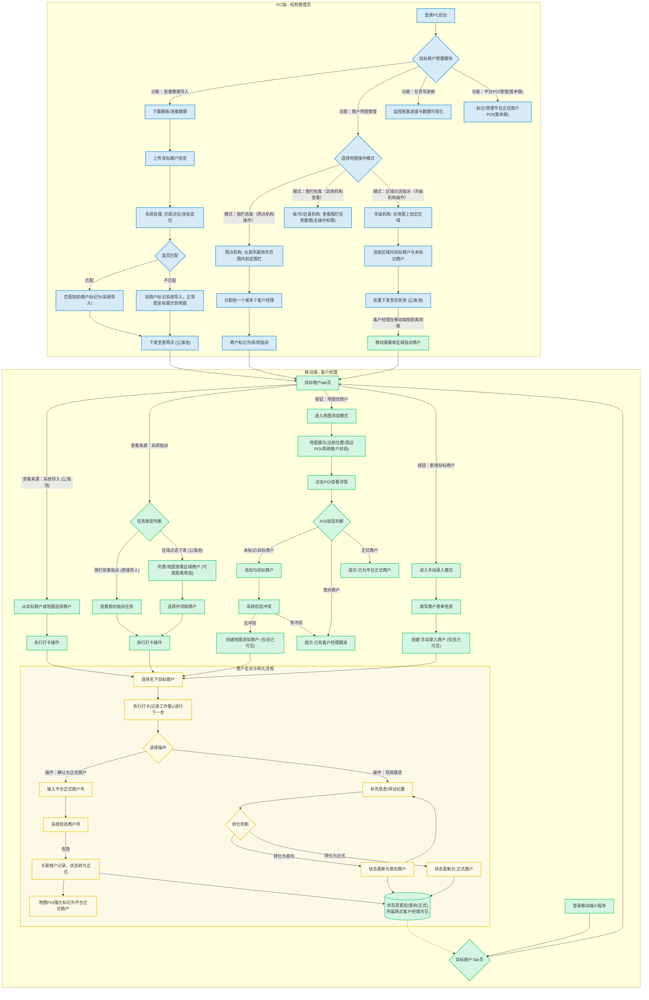

1. 引言
1.1. 项目背景
当前的目标商户走访功能，主要依赖机构在PC后台导入商户信息或客户经理自行拓展并手动录入。商户信息下发后，客户经理在移动端进行走访、打卡，并逐步将其转化为平台的正式商户。此模式下，商户的发现和覆盖范围有一定局限性。
为提升商户拓展效率和覆盖面，计划引入腾讯地图服务及其点位商户信息，并结合机构的区域化管理策略。这将使客户经理能通过地图直观发现潜在商户，机构也能通过地图进行更精细化的区域性战略部署和任务指派，同时逐步沉淀平台自有的商户数据资产。
1.2. 项目目标
- 提升商户发现效率：客户经理可通过地图快速发现周边及指定区域内的潜在商户，或接收上级指派的明确拓客目标。
- 扩大商户覆盖范围：利用腾讯地图的POI数据，结合机构导入的商户信息，拓展更多潜在商户资源。
- 增强机构拓展能力：机构可在PC端通过批量导入已知商户信息。**仅网点机构**可在其所属**地市范围**内通过地图进行围栏划分与任务指派给客户经理，**仅市级机构**可通过地图直接点选区域内**目标商户和未标记商户**进行指派（下发至任务池，由客户经理按距离领取），实现精准拓客和进度监控。
- 优化用户体验：提供更直观、便捷的商户查找、分配和管理方式。
- 构建平台数据资产：通过标记和数据沉淀，逐步完善平台自有的POI点位系统。
1.3. 名词解释
- POI ：地图服务商（如腾讯地图）提供的商户点位信息，或平台自身积累的商户点位信息。
- 目标商户：需要客户经理进行走访和转化的商户。来源多样，
- 意向商户：客户经理走访后，有初步合作意向的商户。
- 正式商户：已完成所有资料补充和流程，成功入驻平台的商户。
- 目标商户来源:
  - 系统导入 (System Import): 由机构在PC端通过文件批量导入后下发的商户。
  - 系统指派 (System Assignment): 由机构在PC端通过地图（围栏或直接点选区域）选定并下发给客户经理的商户。
  - 地图添加 (Map Addition): 由客户经理在移动端通过地图搜索并自主添加的POI商户。
  - 手动录入 (Manual Entry): 由客户经理在移动端手动填写信息录入的商户。
- 公海池（目标商户）：特指"系统导入和点选指派"来源的目标商户，在被客户经理打卡"领取"前，所属机构权限范围内的客户经理均可见。其他来源的商户可见性遵循特定规则。
- 打卡：客户经理对目标商户进行实地走访并进行记录的操作。
- 围栏拓客：**仅网点机构**在地图上划定地理区域（其所属**地市范围**内），并将此区域内的拓客任务分配给客户经理的模式。**其他级别机构（省、市、区县）主要为查看权限。**
1.4. 目标用户
- 客户经理：移动端小程序使用者，负责商户走访和转化。
- 机构管理员（省、市、区县、网点各级机构）：PC后台使用者，负责商户管理、任务下发和进度监控。
2. 整体方案概述
新的目标商户走访方案将围绕客户经理的拓客来源多样化、机构任务分配的灵活性以及平台数据资产的积累进行设计。
- PC端（机构）：
  - 目标商户下发（目标商户列表）：
    - 批量导入：支持机构上传商户信息文件（名称、地址等），系统处理后下发。此部分商户标记为"系统导入"。
    - 地图指派：
      - **围栏拓客（网点机构专属）**：**仅网点机构**可操作，在其所属**地市范围**内划定拓客围栏，并将任务指派给一个或多个客户经理。**其他机构（省、市、区县）仅能查看数据，不能操作。**
      - **区域点选指派（市级机构专属）**：**仅市级机构**可操作，在地图上划定区域，将该区域内的**目标商户和未标记商户**批量下发至任务池。客户经理根据距离远近领取这些商户任务。
    - 通过以上地图方式下发的商户标记为"系统指派"。
  - 任务监控与管理（任务驾驶舱）：监控各类下发任务的进度和成果。
  - 平台POI管理：在地图上标记平台正式商户，管理平台自有POI数据。
- 移动端（客户经理）：
  - 任务接收与处理（目标商户tab）：
    - 接收"系统导入"商户：权限范围内可见，先到先打卡（领取）。
    - 接收"系统指派"商户：权限范围内可见；若直接指派到人（通过网点围栏拓客），则仅该客户经理可见；若为市级区域点选下发的，则客户经理可按距离领取。
  - 自主拓客（目标商户tab）：
    - 地图添加：在地图上查找附近未合作POI，添加为目标商户，标记为"地图添加"，仅自己可见。
    - w手动录入：若地图无法找到，可手动录入商户信息，标记为"手动录入"，仅自己可见。
  - 商户走访与转化（意向和正式商户tab）：
    - 对名下目标商户进行走访。走访时可关联平台正式商户：若目标商户实际已是平台正式商户，可录入正式商户号进行关联，该目标商户记录即转为正式商户的走访记录，并在地图上强化标记。
    - 补充信息，将目标商户逐步转化为意向商户、正式商户。
  - 信息共享：当目标商户转化为意向商户或正式商户后，同一网点下的客户经理均可见其基本信息和状态。
3. 功能需求
3.1. 移动端（客户经理小程序）
3.1.1. 目标商户获取与列表

- 目标商户Tab页：集中展示所有来源的目标商户。
- 顶部展示tab标签、筛选、按钮等，中部展示地图区域，底部展示目标商户列表，地图点击某个点位或列表点击某个商户可以相互定位联动。
- 商户来源与标记：列表中清晰展示每个目标商户的来源标记："系统导入"、"系统指派"、"地图添加"、"手动录入"。
- 可见性规则：
  - 系统导入：权限范围内客户经理均可见（公海池模式，打卡后归属）。
  - 系统指派：
    - 若为**网点机构通过围栏拓客**直接指派给某客户经理：则仅该客户经理可见。
    - 若为**市级机构通过区域点选指派**下发到任务池：则权限范围内的客户经理均可见，可按距离排序后领取。
  - 地图添加：仅添加的客户经理可见。
  - 手动录入：仅录入的客户经理可见。
- 操作按钮：
  - "新增目标商户"（手动录入入口）。
  - "地图找商户"（地图添加入口）。
3.1.2. 地图找商户（地图添加模式）
- 入口：点击"地图找商户"按钮。
- 地图展示：
  - 默认加载客户经理当前位置，地图默认展示15级视图，默认展示当前客户经所在县/市，所有类型的商户（未标记、已标记【目标商户、意向商户、正式商户】）。
  - 不同状态的商户（未标记商户、我方目标商户、意向商户、正式商户）应有清晰的图标和颜色区分。
- POI信息与操作：
  - 点击地图上的POI点位，弹出信息窗。
  - 若该POI点位未被标记或标记为目标商户，则提供"添加为目标商户"按钮，意向商户则提示：该商户已有客户经理跟进，请重新选择，正式商户则提示：该商户已为平台正式商户，请重新选择。
- 转化为目标商户（地图添加）：
  - 点击"添加为目标商户"后，系统需先进行校验。
  - 根据目标商户是否已有归属客户经理，若已是系统内其他客户经理的"地图添加"或"手动录入"目标商户，或机构已指定客户经理，则提示"该商户已有客户经跟进，请重新选择"。
  - 若不存在冲突：创建新的目标商户记录，来源标记为"地图添加"，该商户直接归属当前客户经理，仅自己可见。
3.1.3. 手动录入目标商户
- 入口：点击"新增目标商户"按钮。
- 表单填写：商户名称、地址（必填）、联系人、电话、行业、备注等。
- 提交后，创建新的目标商户记录，来源标记为"手动录入"，该商户直接归属当前客户经理，仅自己可见。
3.1.4. 接收指派任务与处理
- 客户经理在"目标商户"列表中可以看到标记为"系统导入"和"系统指派"的商户。
- 对于"系统指派"中通过**网点机构围栏拓客**（在所属**地市范围**内操作）指派的任务，可在地图上查看高亮任务区域及区域内的目标POI。
- 对于"系统指派"中通过**市级机构区域点选指派**下发的（包含**目标商户和未标记商户**）任务，客户经理可在任务列表或地图上查看这些商户，并按距离领取。
- 客户经理可对这些指派的商户进行打卡、走访、转化。
3.1.5. 商户走访与转化流程
- 选择商户：从目标商户列表中选择商户进行操作。
- 打卡操作：，正常走访可进行打卡统计工作量
- 关联正式商户：
  - 在走访目标商户时，客户经理可选择操作"确认为正式商户"的操作，可在目标或意向商户进行确认。
  - 系统提供输入框，让客户经理输入该商户对应的"平台正式商户号"。
  - 提交后，系统校验正式商户号有效性。
  - 若有效：
    - 当前目标商户记录与该正式商户记录进行关联。
    - 该目标商户的状态在提交后转为"正式商户"。
    - 在PC端地图及客户经理端地图上，该POI点位应被标记或强化显示为"平台正式商户"。
- 信息完善与状态流转：
  - 补充商户详细信息、上传照片、记录拜访纪要等。
  - 根据沟通结果，可将目标商户转化为"意向商户"。
  - 进一步跟进，最终转化为"正式商户"。
- 状态变更后的可见性：当目标商户被任何客户经理成功转化为"意向商户"或"正式商户"后，该商户的基本信息和当前状态对所属网点下的所有客户经理可见。
3.2. PC端（机构后台）
3.2.1. 目标商户管理模块
- 包含现有目标商户列表管理功能（筛选、排序、查看详情等）。
- 新增入口/功能模块："批量数据导入"、**"围栏拓客（网点机构专属，地市范围操作）"**、**"区域点选指派（市级机构专属，下发目标及未标记商户）"**（包含地图拓客功能）。
3.2.2. 批量数据导入 (对应来源："系统导入")
- 机构下载标准Excel/CSV模板，填写商户信息（核心字段：商户名称、详细地址等）。
- 上传文件，优先匹配购买的点位数据，匹配逻辑待定，匹配不到的按照坐标定位地图即可。
- 导入成功后，这些目标商户按照距离原型自动展示。
- 商户来源标记为"系统导入"。
3.2.3. 商户地图管理 (对应来源："系统指派")
- 商户任务列表
  - 展示围栏拓客和区域点选指派的目标商户走访任务数据。比如：任务编号、任务名称、机构级别、机构名称、目标商户数、客户经理、创建时间、更新时间等。
- 地图界面功能：
  - 点击某个任务进行详情页或围栏拓客、区域点选指派的新增界面，展示腾讯地图购买的POI点位。
  - 支持操作地图，可以划分区域等。
- **围栏拓客任务（网点机构操作）**：
  - **网点机构**：**仅网点机构**可在其所属**地市地图范围**内划定拓客围栏区域。
  - 将此区域内的拓客任务（包含区域内的目标POI列表）分配给一个或多个客户经理。
  - 任务包含名称、指派客户经理等属性。
  - **其他机构（省、市、区县）**：可查看已下发的围栏任务范围及相关数据，但无权进行围栏划分和任务指派操作。
- **区域点选指派（市级机构操作）**：
  - **市级机构**：**仅市级机构**可在地图上划定区域。
  - 系统自动选取该区域内的**目标商户和未标记商户**。
  - 将这些选取的商户批量下发至任务池，客户经理可在移动端根据距离远近自行筛选并领取这些商户任务。
  - 任务包含区域范围、商户总数等信息。
- 平台POI标记与管理（当前暂时未做功能界面）
3.2.4. 任务驾驶舱（地图可视化）
- 可视化展示拓展相关数据。
- 在地图上查看各层级拓客任务区域、指派商户的分布及客户经理的拓客进度（打卡、转化状态等）。
- 支持数据钻取和多维度分析。

4. 目标商户走访业务流程图

5. 非功能性需求
4.1. 性能
- 地图加载、POI点位渲染（腾讯POI及大量平台POI）速度应流畅。
- 大量POI数据展示时，进行性能优化（点聚合、分级加载等）。
- 后台批量导入、围栏任务分配操作响应时间应在可接受范围内。
4.2. 可用性
- 地图操作、区域绘制、任务分配流程应符合用户习惯，简单易用。
- 各层级机构的操作权限和界面应清晰。
4.3. 数据准确性与同步
- 腾讯地图POI数据：应定期或实时（根据API能力）更新。
- 平台POI数据：
  - 支持在地图上标记已合作的正式商户，用于区分腾讯地图POI与平台自有商户点位。
  - 逐步建立和完善平台自有的POI数据库，该数据库包含腾讯POI数据以及平台自行验证、补充和标记的信息（如准确的品类、经营状态、我方合作状态等）。
  - 考虑POI信息变更（如商户关闭、地址迁移）的处理和平台数据更新机制。
- 系统内商户信息与地图POI信息的关联应准确。
4.4. 扩展性
- 系统设计应考虑未来可能接入更多地图服务商或POI数据源。
- 平台自有POI系统应具备良好的扩展性。
4.5. 安全性
- 确保地图API密钥等敏感信息的安全。
- 用户数据访问权限严格控制，符合现有权限体系及层级管理需求。
4.6. API调用与成本
- 合理设计API调用逻辑，控制腾讯地图服务的使用成本。
- 监控API调用频率和用量，特别是地理编码等可能产生较高费用的服务。
6. 原型设计
5.1. 移动端
- 目标商户列表需清晰展示来源和归属状态。
- 地图上POI点位根据来源（腾讯、平台）、状态（未处理、目标、意向、正式、他人处理中）及是否为指派任务，使用不同颜色/图标清晰区分。
5.2. PC端
- **网点机构的围栏拓客**（**地市范围**内操作）创建、下发、查看流程应直观。**其他机构的查看权限应清晰，无操作权限。**
- **市级机构的区域点选指派**（下发**目标商户和未标记商户**）操作应便捷，**客户经理端按距离领取流程应顺畅。**
7. 上线后效果衡量指标 (Metrics)
- 客户经理端：
  - 地图找商户功能使用频率/用户数。
  - 通过地图添加的目标商户数量。
  - 指派任务的完成率（按区域/商户数）。
- 机构端：
  - 机构批量导入商户的频率/数量。
  - **网点机构**创建和下发围栏任务（**地市范围**内操作）的频率/数量。
  - **市级机构**创建和下发区域点选任务（下发**目标商户和未标记商户**）的频率/数量。
  - 任务区域内商户拓展完成率和转化率。
- 平台POI系统：
  - 平台标记/验证的POI数量增长。
  - 平台POI数据在拓客中的使用率。
- 整体：
  - 平台整体目标商户、意向商户、正式商户增长率变化。
  - 商户覆盖的地理范围和密度变化。
8. 未来迭代方向
- 智能路线规划：为客户经理规划当日最优走访路线。
- 竞品分析与市场洞察：在地图上展示竞品分布，分析市场空白区和高潜力区。
- 构建完善的平台自有POI系统：包括数据清洗、融合、更新机制、质量评分体系，并可能开放API服务。
- 客户经理轨迹与行为分析：优化管理和资源分配（需注意隐私合规）。
- 离线地图与数据：支持网络不佳地区的核心拓客操作。
9. 待讨论与确认事项
- "系统导入"和"系统指派"给区域/机构时，"权限范围内客户经理可见"的具体定义和实现方式？是否需要更细化的权限配置？
- 客户经理在地图上添加POI时，查重逻辑的优先级和冲突处理机制
- 网点下客户经理可见"意向"和"正式"商户的具体信息范围？是否包含所有历史记录还是仅基本信息和状态？
- PC端机构直接地图点选指派商户时，若该商户已被其他客户经理"地图添加"或"手动录入"且未转化，如何处理冲突？优先指派还是提示冲突？
- **市级机构**通过"区域点选指派"下发（包含**目标商户和未标记商户**）到任务池的商户，客户经理端如何展示和领取？是否默认按距离排序，并提供筛选机制？领取后如何归属？

当前这个prd还需要更新下，我梳理下场景：
一.客户经理端：
1.客户经理可以接收机构下发导入的商户进行走访转化，标记为：系统导入。权限范围内客户经理都可见。
2.客户经理可以接收机构通过地图找商户下发来的商户进行走访转化，标记为：系统指派。
    - 若为**网点机构通过围栏拓客**直接指派给客户经理，则仅该客户经理可见。
    - 若为**市级机构通过区域点选指派**下发到任务池，则权限范围内的客户经理均可见，可按距离排序后领取。
3.客户经理可以手动通过地图找商户，在地图中根据当前位置找附近不属于意向或正式的商户，可以添加为目标商户，进行走访。标记为：地图添加，仅客户经理可见
4.若客户经理通过地图找不到想要的商户。则提供手动录入的功能，录入为目标商户，进而走访转化，标记为：手动录入，仅客户经理可见。
以上是目标商户的来源。
二.目标商户进行走访时，客户经理可先确认是否为平台正式商户，若为正式商户，则提供正式商户号，提交后该s商户与正式商户关联，转为正式商户记录走访信息，并在地图点位进行标记正式商户。
三.当目标商户进行完善转为意向商户和正式商户后，网点下客户经理都可见。

四.机构pc端：
1. 机构可在目标商户列表进行批量导入下发目标商户。
2. **围栏拓客（网点机构专属）**：**仅网点机构**在商户地图中可（在其所属**地市范围**内）划分围栏区域，然后将任务指定给一个或多个客户经理。**其他机构（省、市、区县）仅能查看数据，不能操作。**
3. **区域点选指派（市级机构专属）**：**仅市级机构**可在商户地图中划定区域，将区域内的**目标商户和未标记商户**批量下发至任务池。客户经理可在移动端根据距离远近自行领取这些商户任务，领取后进行走访转化。
以上是机构的下发目标商户的方式。

